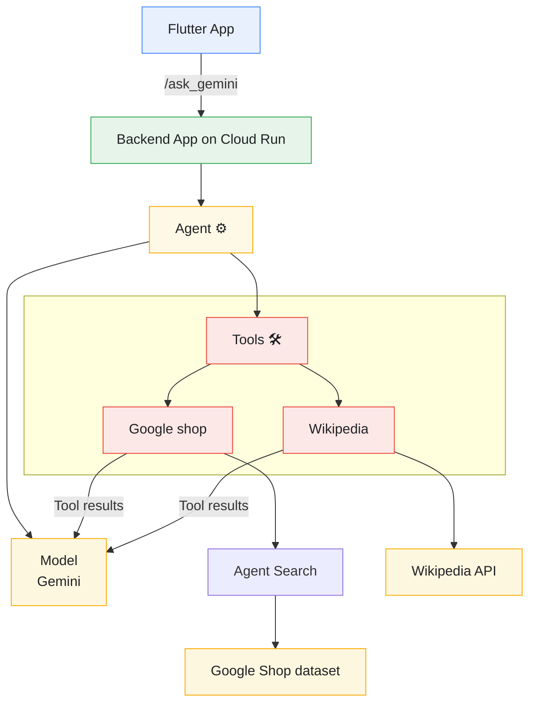

# 🤖 Langchain Flutter App 🚀

https://github.com/user-attachments/assets/3505e9af-2fe5-4bd0-9767-4ab7b80c7cce

> 🎥 Watch **Langchain Flutter App** in action!

> [!CAUTION]
> The Cloud Run deployment is currently unavailable because the Google Cloud project has exhausted its available credits. The project was previously deployed and tested successfully on Google Cloud Run.

---

## Table of Contents

- [Introduction](#introduction)
- [Architecture Diagram](#architecture-diagram)
- [Project Structure](#project-structure)
- [Features](#features)
- [Tech Stack](#tech-stack)
- [Application Workflow](#application-workflow)
- [Screenshots](#screenshots)
- [Generative AI Capabilities & Integration](#generative-ai-capabilities--integration)
- [AI-Assisted Development](#ai-assisted-development)
- [Google Skills Challenge Lab Reference](#google-skills-challenge-lab-reference)
- [Future Enhancements](#future-enhancements)
- [Resources](#resources)
- [Disclaimer](#disclaimer)
- [Contributing](#contributing)
- [License](#license)
- [Author](#author)

---

## Introduction

**Langchain Flutter App** is a modern cross-platform mobile and web application developed as part of advanced Google Cloud and generative AI learning experiences. It bridges a responsive Flutter client interface with a powerful serverless backend powered by **LangChain**, **LangGraph**, and **Gemini models**, hosted on **Google Cloud Run**.

The project explores how to build autonomous agentic workflows capable of dynamic tool-calling—specifically leveraging Agent Search over the Google Shop dataset alongside the Wikipedia API to retrieve, synthesize, and present real-time structured retail data and encyclopedic knowledge to users.

The repository features a monorepo workspace containing the core Flutter application, companion chat modules, and backend orchestration logic designed for scalable cloud deployment.

The project demonstrates practical concepts in cross-platform state management, autonomous agent orchestration, tool routing, prompt engineering, and cloud-native serverless deployment.

This repository documents my implementation and learning with Google Cloud Generative AI and LangChain agent architectures, including application structure, supporting modules, and learning resources.

---

## Architecture Diagram

The following diagram illustrates the architecture of the application deployed on Google Cloud and connected to the Flutter client:



> [!NOTE]
> This diagram provides a high-level overview of the client-server interaction and tool orchestration across Google Cloud managed services and external APIs.

### Architecture Overview

1. **Flutter App**
   - Cross-platform user interface for sending natural language queries (`/ask_gemini`) and rendering rich streaming chat responses.
  
2. **Backend App on Cloud Run**
   - Containerized server application managing request routing, session management, and LangChain/LangGraph agent execution loops.
  
3. **Gemini Model API**
   - Serves as the core multimodal language model driving intent parsing, reasoning, and response generation.
  
4. **Tools Router & Integration**
   - Dynamically selects appropriate execution tools based on user queries.
   - **Google Shop Tool:** Queries structured e-commerce data using Agent Search over the Google Shop dataset.
   - **Wikipedia Tool:** Fetches up-to-date summaries and reference data from the external Wikipedia API.
  
---

## Project Structure

The repository organizes the source code into a monorepo structure separating the Flutter client, backend modules, and configuration assets.

```text
langchain-flutter-app/                           # Core workspace root directory
├── langchain-flutter-app/                       # Core Flutter cross-platform mobile/desktop client
│   ├── .dart-tool                               # Dart compiler and tool execution cache
│   ├── .dart                                    # Local Dart SDK configuration and analysis state
│   ├── .dartServer / .analysis-driver           # Dart analysis server background driver data
│   ├── .oh-my-bash                              # Shell environment configuration and prompt utilities
│   ├── ag-web/                                  # Web and backend service components (FastAPI / Agent tools)
│   ├── chat_app/                                # Core cross-platform Flutter chat client application
│   ├── flutter/                                 # Flutter framework modules, SDK files, or CI pipelines
│   └── bashrc.pre-oh-my-bash                    # Terminal shell backup configuration profile
│   
├── .gitignore                                   # Global root ignore rules for caches and binaries
├── CODE_OF_CONDUCT.md                           # Community conduct guidelines
├── CONTRIBUTING.md                              # Contribution workflows and guidelines
├── LICENSE                                      # Open-source license terms
├── README.md                                    # Project documentation
└── SECURITY.md                                  # Security vulnerability reporting policy
```

> [!NOTE]
> This tree represents the monorepo workspace structure. Refer to individual subdirectories for detailed component layouts.

### Key Components

- **`langchain-flutter-app/`** — Core Flutter project directory containing screens, state logic, and client widgets.
- **`chat_app/`** & **`ag-web/`** — Companion service and web interface modules supporting agent interaction workflows.
- **`Dockerfile`** — Configuration to containerize the application for serverless deployment on Cloud Run.
- **`.gitignore`** — Excludes local build caches (`.dart_tool`, `.pub-cache`), environment files, and IDE metadata from version control.
- **`CONTRIBUTING.md`, `CODE_OF_CONDUCT.md`, and `SECURITY.md`** — Outline contribution standards, community conduct, and security-reporting guidelines.

---

## Features

- **Cross-Platform Flutter Frontend:** Responsive mobile and desktop user interface delivering a smooth conversational experience.
- **Autonomous Agent Tool-Calling:** Dynamic decision-making where the LLM selects between catalog search and encyclopedic lookup tools based on user prompts.
- **Agent Search over Google Shop Dataset:** Precision semantic search and retrieval of product pricing, availability, and attributes.
- **Wikipedia API Integration:** Real-time retrieval of external knowledge to supplement agent answers.
- **Cloud Run Serverless Hosting:** Scalable, containerized backend deployment ensuring high availability.
- **Monorepo Workspace Architecture:** Cleanly organized multi-app repository supporting cohesive development across client and backend services.
- **Robust Error Handling:** Graceful fallbacks when external APIs or model endpoints experience rate limits or downtime.

> [!NOTE]
> Actual execution behavior depends on valid GCP credentials, API enablement, and configuration settings.

---

## Tech Stack

| Technology | Purpose |
|---|---|
| **Flutter & Dart** | Cross-platform mobile and desktop client application framework |
| **LangChain & LangGraph** | Agent orchestration, state management, and tool-calling loops |
| **Python & FastAPI** | Backend web framework for handling agent routes and API requests |
| **Google Cloud Run** | Scalable serverless container hosting platform |
| **Gemini Models & Vertex AI** | Core LLM reasoning, intent parsing, and natural language generation |
| **Agent Search / Discovery Engine** | Conversational search over structured e-commerce data |
| **Google Shop Dataset** | Retail product catalog data source |
| **Wikipedia API** | External knowledge retrieval tool |
| **Docker** | Containerization of application services |
| **Git & GitHub** | Version control and source code hosting |

> [!NOTE]
> The table describes the technologies and architectural patterns reflected in the project implementation.

---

## Application Workflow

**Langchain Flutter App** is structured around intuitive user interactions and autonomous agent execution loops.

### 1️⃣ Environment & Dependency Setup

- Configure project IDs, API keys, and model parameters in local environment variables or configuration files.
- Fetch Flutter dependencies using `flutter pub get`.

### 2️⃣ Containerization & Cloud Deployment

- Build the container image using the provided `Dockerfile`.
- Deploy backend services to Google Cloud Run with appropriate IAM permissions and Vertex AI access.

### 3️⃣ Client-Side Request Initiation

- Users enter conversational queries (e.g., "Find me a lightweight laptop under $1,000" or "What is quantum computing?") in the Flutter chat interface.
- The app sends an HTTP POST request (`/ask_gemini`) to the Cloud Run backend.

### 4️⃣ Autonomous Agent Reasoning & Tool Execution

- The LangChain agent evaluates the prompt and determines whether a tool is required.
- If shopping-related, it queries the Google Shop dataset via Agent Search.
- If general knowledge, it queries the Wikipedia API.
- Tool results are fed back into the Gemini model for synthesis.

### 5️⃣ Response Rendering in Flutter

- The structured response is transmitted back to the Flutter client and rendered cleanly in chat message bubbles with markdown support.

--- 

## Screenshots

This section will showcase the **Flutter chat** interface, agent tool-calling logs, and Google Cloud Run deployment metrics.

### Google Cloud Console Home Dashboard


### Google Cloud AI Applications & Search Configuration


### Project Source Code


### Gemini Platform


### JupyterLab Environment


### Flutter Chat Interface


### Agent-Driven E-Commerce Journey


### Google Cloud Monitoring & Logging


---

## Generative AI Capabilities & Integration

### LangChain Agent Tool-Calling

- Orchestrates multi-step reasoning loops where the LLM acts as an autonomous agent deciding when and how to invoke custom tools.

### Agent Search over Google Shop Dataset

- Leverages enterprise search capabilities to query product catalogs with high semantic precision.

### Gemini Model Reasoning

- Utilizes advanced Gemini models for contextual understanding, instruction following, and natural language formatting.

---

## AI-Assisted Development

AI tools can support the development and exploration of modern generative AI applications by helping explain unfamiliar code, investigate implementation issues, understand agent architectures, and improve technical documentation.

During the development and learning process for Langchain Flutter App, AI assistance may be used to support activities such as:

- Understanding LangChain agent executors, custom tool definitions, and tool-calling schemas.
- Exploring Flutter state management and asynchronous chat stream rendering.
- Configuring Cloud Run container deployments and environment variable injection.
- Investigating API error handling and rate-limit recovery strategies.
- Improving project documentation, code structure, and repository presentation.

AI-generated suggestions and code should be reviewed critically, verified against the actual implementation, and tested before being adopted.

---

## Google Skills Challenge Lab Reference

This project was developed after completing the corresponding hands-on Google Cloud learning pathway and lab modules.

### Challenge Lab

**Integrate a LangChain Agent with a Flutter App Using Agent Platform**

[Open the Google Skills lab](https://www.skills.google/paths/1282/course_templates/1162/labs/686811)

### Learning Context

The repository serves as a personal source-code project associated with this learning experience.

It provides a place to explore and document:
- Cross-platform Flutter client integration with AI backends.
- LangChain and LangGraph agent orchestration.
- Tool-calling patterns using Agent Search and external APIs.
- Google Cloud Run serverless container deployment.

For official learning objectives, instructions, and environment setup requirements, refer to the Google Skills lab link provided above.

---

## Future Enhancements

The following ideas could be considered for future versions of **Langchain Flutter App**:

- **Chat History Persistence:** Add local SQLite or cloud database storage to maintain chat sessions across app launches.
- **Voice Input Support:** Integrate speech-to-text for hands-free conversational agent queries.
- **Multi-Agent Collaboration:** Implement specialized sub-agents (e.g., a dedicated shopping assistant agent alongside a research agent).
- **Streaming UI Updates:** Enhance the Flutter frontend to display real-time tool execution status badges (e.g., "Searching Google Shop catalog...").
- **Comprehensive Unit Testing:** Add rigorous widget tests for Flutter UI components and mock tests for LangChain tool execution.

> [!IMPORTANT]
> These are potential improvements, not claims that the features are already fully implemented.

---

## Resources

[](https://docs.flutter.dev/learn/pathway)
[](https://docs.flutter.dev/reference/learning-resources)
[](https://docs.flutter.dev/)
[](https://cloud.google.com/docs)
[](https://cloud.google.com/run/docs)
[](https://cloud.google.com/vertex-ai/docs)
[](https://ai.google.dev/gemini-api/docs)
[](https://fastapi.tiangolo.com/)
[](https://docs.docker.com/)
[](https://docs.python.org/3/)
[](https://git-scm.com/doc)
[](https://docs.github.com/)

---

## Disclaimer

**Langchain Flutter App** is a learning and demonstration project associated with Google Cloud training.

The project utilizes third-party technologies and services, including Google Cloud Run, Vertex AI, Gemini, LangChain, and external APIs. The availability, functionality, pricing, and policies of external cloud services are subject to their respective providers' terms.

Access to Google Skills lab environments and temporary GCP projects expires after completion. A completed lab does not imply permanent public availability of the deployed backend service.

This repository is intended for educational and demonstration purposes. Do not commit API keys, access tokens, service-account credentials, or private configuration files to source control.

---

## Contributing

Contributions are welcome! If you would like to improve **Langchain Flutter App**, fix a bug, add tests, or improve the documentation, please review the following guidelines:

- [Contributing Guide](./CONTRIBUTING.md)
- [Code of Conduct](./CODE_OF_CONDUCT.md)
- [Security Policy](./SECURITY.md)

Please ensure that contributions are focused, documented, and tested where appropriate. Never include secrets or private configuration in issues, commits, or Pull Requests.

---

## License

This project is licensed under the **Apache License 2.0**.

See the [LICENSE](./LICENSE) file for details.

---

## Author

[**Sahil Sharma**](https://github.com/sahil-me)

Thank you for exploring **Langchain Flutter App**! If you find the project useful, consider giving the repository a ⭐ to show your support.
